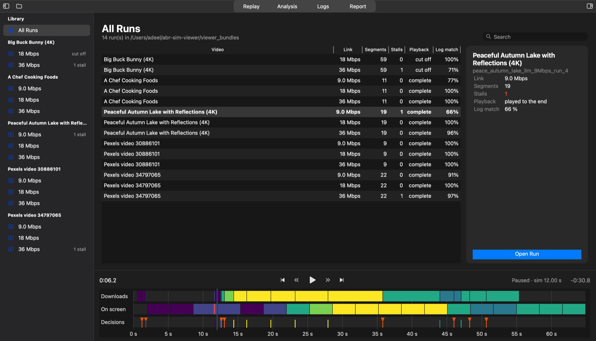
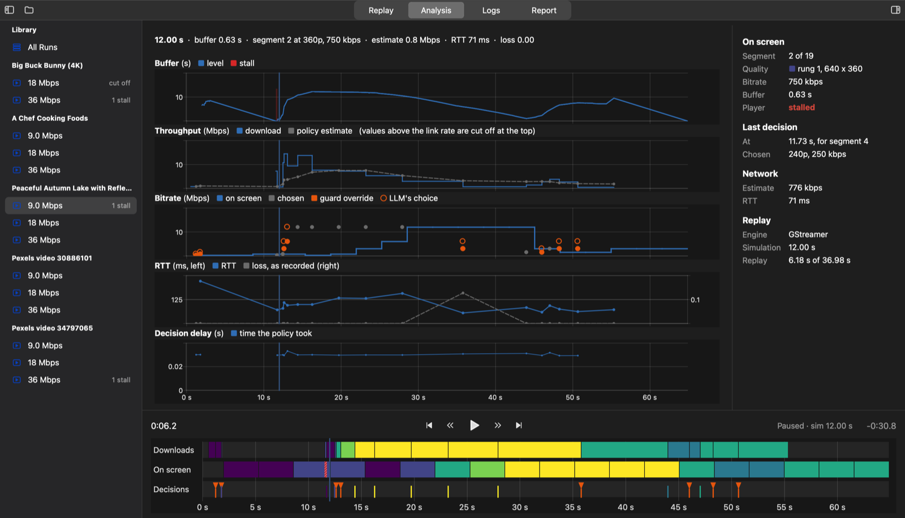

# Stream Inspector


A Mac app (and Qt desktop app) for ns-3 adaptive video streaming simulations. It opens a simulation run
bundle and shows what the simulated user saw, segment by segment: the quality the LLM ABR
policy chose, the experienced video with its stalls, the buffer, throughput, RTT and loss over
time, and the simulation logs, all linked to one time cursor.

Built with **C++20**, **Qt 6** and **GStreamer**. The project is called abr-viz; the application
is Stream Inspector.


## What it shows

The window is laid out like a macOS app: a sidebar, a toolbar, the content, an inspector and
a transport bar.

- **Sidebar**: All Runs, then each video with its runs by link rate; a run that stalled or was
  cut off by the end of the simulation says so. Selecting a run opens it.
- **All Runs**: the runs of the folder with link rate, segments, stalls, playback and how well
  the logs match the exported data; search, and the details of the selected run. Without a
  folder, a welcome screen with the recent folders.
- **Toolbar**: a segmented control for the views of the open run:
  - **Replay**: the video the simulated user saw, each segment at the rung it was played at,
    stalls as frozen frames, cut off where playback stopped.
  - **Analysis**: buffer, throughput and the policy's estimate, chosen and played bitrate,
    RTT and loss, and decision delay, with a readout at the cursor.
  - **Logs**: `sim.log` and the policy log in one indexed view, filtered in the background,
    following the cursor.
  - **Report**: QoE numbers, with the six that `summary.json` reports checked against it, and
    the run's settings and ladder.
- **Inspector**: what was on screen at the cursor (segment, rung, resolution, bitrate, buffer,
  stall), the policy's last decision, the network as last measured, and the engine and times.
- **Transport bar**: elapsed and remaining replay time, play, 5 s and segment steps, and the
  segment timeline (downloads, segments on screen and decisions, coloured by rung, with stalls,
  guard overrides and the cut-off marked), which is also the scrubber.

Clicking or dragging in the timeline or a chart moves the cursor; playing the replay moves it
too.

| All Runs | Analysis | Report |
| --- | --- | --- |
|  |  |  |

## Replay engines

| Engine | How it works | When |
| --- | --- | --- |
| GStreamer (default) | plays the segment files directly: `splitmuxsrc ! decodebin3 ! videoconvert ! videoscale ! appsink`, frames handed to Qt without copying; the engine times the frames itself, and a stall holds the last frame | built with `ABR_WITH_GSTREAMER=ON` |
| Pre-rendered | `ffmpeg` renders the experienced video once (in parallel, cached), played with Qt Multimedia | always available; used automatically if GStreamer cannot show a run |

Choose in Settings (⌘,) or Playback, Engine (saved), or with `--engine gstreamer|prerendered`.
Both engines show the same picture at the same cursor position; a test checks this on a full
bundle. All 14 runs were played start to finish with each engine's frame rate checked: 25,
29.97, 30 and 59.94 fps videos all play at their own rate, with gaps only at the stalls.

## Measured

Apple M4 (10 cores, 16 GB), macOS 27.2, Qt 6.9.2, GStreamer 1.28.9, ffmpeg 9.0.2, release
build. Big Buck Bunny at 36 Mbps: 59 segments, 4K top rung, 111 s of replay. Numbers from
`abrviz --profile 10` and the tools below, three runs each, typical value.

| What | Result |
| --- | --- |
| Load and check all 14 bundles (`print_report viewer_bundles`) | 0.04 s warm, 0.29 s cold |
| Start the app, read the folder and open BBB 36 | 0.11 s |
| Index `sim.log` and the policy log (12 k lines) | 20 ms after that |
| GStreamer engine: first picture | 40–100 ms |
| GStreamer engine: all 111 s of BBB 36 (4K rung) | 3,323 of 3,324 frames shown, the only gap is the 0.36 s stall |
| GStreamer engine: 10 s across the stall | 29 frames/s shown (video 30, none during the stall), 60 % of one core, 420 MB peak |
| Render the experienced video (55 parts, 10 `ffmpeg` at once) | 13.7 s (101 s of CPU); 3.9 s for an 11-segment run |
| Pre-rendered engine: 10 s of playback | 29.9 frames/s, 57 % of one core, 230 MB peak |

CPU is for the whole app, including repainting the panels that follow the cursor.

## Requirements

- CMake 3.24+, Ninja, a C++20 compiler (Apple clang 15+, GCC 13+)
- Qt 6.8+ with Widgets, Charts, Multimedia, Svg, Concurrent and Test
- GStreamer 1.22+ with the base, good, bad and libav plugins (optional, see below)
- ffmpeg (for the pre-rendered replay engine)

macOS (Homebrew):

```sh
brew install qt cmake ninja gstreamer ffmpeg
```

## Build and test

```sh
cmake --preset debug
cmake --build --preset debug
ctest --preset debug
```

Presets: `debug`, `release`, `nogst` (without GStreamer), `asan` (AddressSanitizer + UBSan),
`tsan` (ThreadSanitizer). Every preset builds with warnings as errors and passes its tests.
On macOS the two tests that play video through Qt Multimedia need the Cocoa platform (their
window is kept off the screen) and are left out of the TSan build, where the TSan runtime can
deadlock inside CoreMedia; the GStreamer engine tests run under TSan.

The GStreamer replay engine is built by default. Configure with `-DABR_WITH_GSTREAMER=OFF`
(or use the `nogst` preset) to build only the pre-rendered engine.

## Running

On macOS the app is `build/<preset>/app/Stream Inspector.app`:

```sh
open "build/release/app/Stream Inspector.app"        # welcome screen, recent folders
APP="build/release/app/Stream Inspector.app/Contents/MacOS/Stream Inspector"
"$APP" viewer_bundles                                # all runs of a folder
"$APP" viewer_bundles --bundle big_buck_bunny_llm_36Mbps_run_2 --time 57
```

On Linux the executable is `build/<preset>/app/stream-inspector`.

| Option | Effect |
| --- | --- |
| `--bundle <name>` | open this bundle of the folder |
| `--time <s>` | move the cursor to this simulation time |
| `--engine gstreamer\|prerendered` | replay engine for this start (overrides the saved choice) |
| `--page library\|replay\|analysis\|logs\|report` | view to show (library is All Runs) |
| `--size WxH` | window size |
| `--screenshot <file.png>` | save a picture of the window once everything is shown, and quit (no window appears) |
| `--profile <s>` | play that many seconds and print load, render and playback numbers |

| Keys (macOS) | Action |
| --- | --- |
| Space | play / pause |
| ⌥← / ⌥→ | back / forward 5 s of replay |
| ⌘[ / ⌘] | previous / next segment |
| ⌘1 … ⌘5 | All Runs, Replay, Analysis, Logs, Report |
| ⌃⌘S / ⌥⌘I | show or hide the sidebar / the inspector |
| ⌘O / ⇧⌘O | open a folder / one run |
| ⌘R | render the video for the pre-rendered engine |
| ⌘I | show the information overlay on the video |
| ⌘, | Settings: engine, overlay, render cache |

On Linux, Ctrl replaces ⌘ and Alt replaces ⌥. Rendered videos are kept in the user cache
folder (`ABRVIZ_RENDER_CACHE` overrides it).

Command-line tools, built next to the app in `build/<preset>/tools/`:

- `validate_bundle <bundle-or-folder>...`: load bundles and report errors and warnings.
- `print_report <bundle-or-folder>...`: the QoE report; exits with 1 if a number disagrees
  with `summary.json`.
- `render_experienced <bundle>`: render the experienced video, as the viewer does.

## Simulation data

The 14 run bundles (about 714 MB) are not stored in git. Download `viewer_bundles.tar` from
the GitHub Releases page and extract it into the repository root as `viewer_bundles/`. Tests
that need it are skipped when it is missing.

## Documentation

- [docs/architecture.md](docs/architecture.md): design, threads, ownership
- [docs/diagrams.md](docs/diagrams.md): class and thread diagrams
- [docs/development-plan.md](docs/development-plan.md): build steps and testing
- [docs/simulation-data.md](docs/simulation-data.md): the simulation bundles and their quirks

## Credits

- *Big Buck Bunny* © Blender Foundation, licensed under
  [CC-BY 3.0](https://creativecommons.org/licenses/by/3.0/).
- The other test videos are from [Pexels](https://www.pexels.com), under the
  [Pexels License](https://www.pexels.com/license/).

## Licence

MIT, see [LICENSE](LICENSE).
