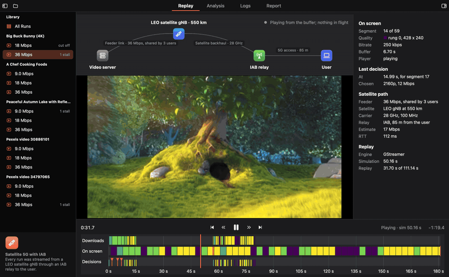
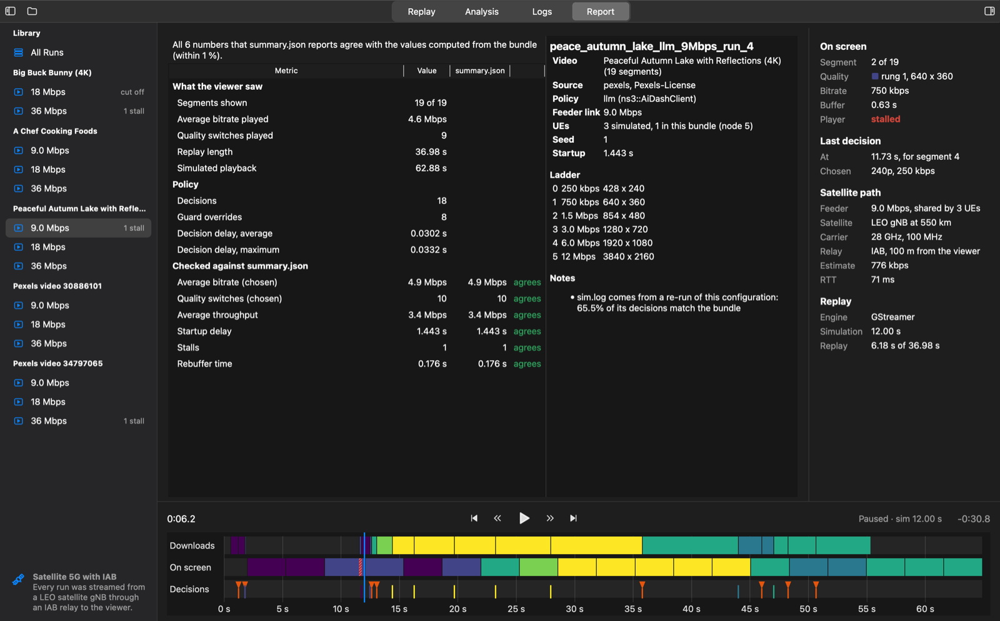

# Stream Inspector


Replays ns-3 simulations of adaptive video streaming over a satellite 5G network with
integrated access and backhaul (IAB). For each run it shows the video the viewer saw, segment
by segment, with its stalls, the bitrate decisions of the LLM ABR policy, the buffer,
throughput, RTT and loss, and the simulation logs.

Network: a LEO satellite gNB at 550 km (28 GHz, 100 MHz) backhauls an IAB relay, which serves
three UEs. The video server reaches the satellite over a feeder link of 9, 18 or 36 Mbps.

Built with C++20, Qt 6 and GStreamer.



## Download

Packages for macOS (Apple silicon), Windows and Linux are on the
[Releases](https://github.com/muhammadadeelzahid/abr-viz/releases) page, with the simulation
runs (`viewer_bundles.tar`). Extract the runs, open the app and choose the `viewer_bundles`
folder.

- macOS: unzip and move the app to Applications. The first time, right-click it and choose
  Open (the app is not notarised).
- Windows: unzip and run `stream-inspector.exe`.
- Linux: `chmod +x` the AppImage and run it.

The packages include ffmpeg and use the pre-rendered engine: the first time a run is played,
its video is rendered (a few seconds) and cached. Build from source for the GStreamer engine.

## Features

- Library of runs grouped by video and feeder link rate, with stalls and cut-off playback marked
- Replay of the video as the viewer saw it, with the network path and the segment in flight
- Charts of buffer, throughput, bitrate, RTT, loss and decision delay
- Indexed, filterable `sim.log` and policy log
- QoE report checked against `summary.json`
- Segment timeline shared by all views

| All Runs | Analysis | Report |
| --- | --- | --- |
|  |  |  |

## Replay engines

- **GStreamer** (default): plays the segment files directly.
- **Pre-rendered**: renders the experienced video once with `ffmpeg`, then plays it with Qt
  Multimedia. Used when GStreamer is not available.

Select the engine in Settings or with `--engine gstreamer|prerendered`.

## Performance

Apple M4, release build, Big Buck Bunny at 36 Mbps (4K top rung, 111 s):

| | |
| --- | --- |
| Open the run | 0.11 s |
| GStreamer playback | 30 fps, 60 % of one core |
| Pre-rendered playback | 30 fps, 57 % of one core |
| Render the experienced video | 13.7 s |

## Requirements

- CMake 3.24+, Ninja, a C++20 compiler
- Qt 6.8+ (Widgets, Charts, Multimedia, Svg, Concurrent, Test)
- GStreamer 1.22+ with the base, good, bad and libav plugins (optional)
- ffmpeg

On macOS:

```sh
brew install qt cmake ninja gstreamer ffmpeg
```

## Build

```sh
cmake --preset release
cmake --build --preset release
ctest --preset release
```

Other presets: `debug`, `nogst` (without GStreamer), `asan`, `tsan`, and `dist` for the release
packages (see `packaging/` and `.github/workflows/release.yml`; pushing a `v*` tag builds all
three and drafts a release).

## Run

```sh
open "build/release/app/Stream Inspector.app"
```

From the command line:

```sh
APP="build/release/app/Stream Inspector.app/Contents/MacOS/Stream Inspector"
"$APP" viewer_bundles --bundle big_buck_bunny_llm_36Mbps_run_2 --time 57
```

On Linux the executable is `build/release/app/stream-inspector`.

| Option | Effect |
| --- | --- |
| `--bundle <name>` | open a run of the folder |
| `--time <s>` | move the cursor to a simulation time |
| `--engine gstreamer\|prerendered` | replay engine |
| `--page library\|replay\|analysis\|logs\|report` | view to show |
| `--size WxH` | window size |
| `--screenshot <file.png>` | save a screenshot and quit |
| `--profile <s>` | play for some seconds and print timings |
| `--record <folder>` | play and save a picture of the window every 100 ms, then quit (`--duration <s>`, default 8) |

| Key | Action |
| --- | --- |
| Space | play / pause |
| ⌥← / ⌥→ | back / forward 5 s |
| ⌘[ / ⌘] | previous / next segment |
| ⌘1 … ⌘5 | All Runs, Replay, Analysis, Logs, Report |
| ⌃⌘S / ⌥⌘I | sidebar / inspector |
| ⌘O / ⇧⌘O | open a folder / a run |
| ⌘R | render the video |
| ⌘, | settings |

The GIF above was made with:

```sh
"$APP" viewer_bundles --bundle big_buck_bunny_llm_36Mbps_run_2 --time 50 --size 1440x900 \
    --record frames --duration 9
ffmpeg -framerate 10 -i frames/frame-%04d.png -vf "fps=8,scale=880:-1:flags=lanczos,\
split[a][b];[a]palettegen=max_colors=144[p];[b][p]paletteuse=dither=bayer" docs/images/demo.gif
```

Command-line tools in `build/release/tools/`: `validate_bundle`, `print_report`,
`render_experienced`.

## Simulation data

The 14 run bundles (about 714 MB) are not in git. Download `viewer_bundles.tar` from the
Releases page and extract it into the repository root as `viewer_bundles/`.

## Documentation

API documentation is generated with Doxygen (`brew install doxygen`):

```sh
cmake --build --preset release --target docs
open build/release/docs/html/index.html
```

- [Architecture](docs/architecture.md)
- [Diagrams](docs/diagrams.md)
- [Development plan](docs/development-plan.md)
- [Simulation data](docs/simulation-data.md)

## Credits

- *Big Buck Bunny* © Blender Foundation, [CC-BY 3.0](https://creativecommons.org/licenses/by/3.0/)
- Other videos from [Pexels](https://www.pexels.com), [Pexels License](https://www.pexels.com/license/)

## Licence

MIT, see [LICENSE](LICENSE).
