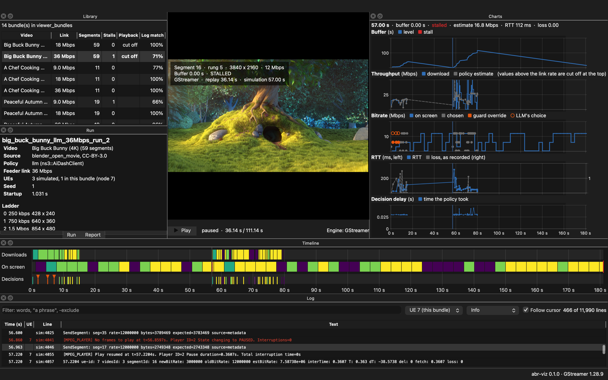

# abr-viz

A desktop viewer for ns-3 adaptive video streaming simulations. It opens a simulation run
bundle and shows what the simulated user saw, segment by segment: the quality the LLM ABR
policy chose, the experienced video with its stalls, the buffer, throughput, RTT and loss over
time, and the simulation logs, all linked to one time cursor.

Built with **C++20**, **Qt 6** and **GStreamer**.



## What it shows

- **Library**: every bundle in a folder, with link rate, segments, stalls, whether playback
  was cut off by the end of the simulation, and how well the logs match the exported data.
- **Replay**: the video the simulated user saw, each segment at the rung it was played at,
  stalls as frozen frames, cut off where playback stopped. An overlay gives the segment, rung,
  resolution, bitrate, buffer level and state.
- **Timeline**: downloads, segments on screen and policy decisions, coloured by rung, with
  stalls, guard overrides and the cut-off marked.
- **Charts**: buffer, throughput and the policy's estimate, chosen and played bitrate, RTT
  and loss, and decision delay.
- **Log**: `sim.log` and the policy log in one indexed view, filtered in the background, that
  follows the cursor.
- **Report**: QoE numbers for the session, with the six that `summary.json` reports checked
  against it.

Clicking or dragging in any timeline or chart moves the cursor; playing the replay moves it
too.


## Replay engines

| Engine | How it works | When |
| --- | --- | --- |
| GStreamer (default) | plays the segment files directly: `splitmuxsrc ! decodebin3 ! videoconvert ! videoscale ! appsink`, frames handed to Qt without copying; stalls hold the last frame on a timer | built with `ABR_WITH_GSTREAMER=ON` |
| Pre-rendered | `ffmpeg` renders the experienced video once (in parallel, cached), played with Qt Multimedia | always available; used automatically if GStreamer cannot show a run |

Choose with Playback, Engine (saved) or `--engine gstreamer|prerendered`. Both engines show
the same picture at the same cursor position; a test checks this on a full bundle.

## Measured

Apple M4 (10 cores, 16 GB), macOS 27.2, Qt 6.9.2, GStreamer 1.28.9, ffmpeg 9.0.2, release
build. Big Buck Bunny at 36 Mbps: 59 segments, 4K top rung, 111 s of replay. Numbers from
`abrviz --profile 10` and the tools below, three runs each, typical value.

| What | Result |
| --- | --- |
| Load and check all 14 bundles (`print_report viewer_bundles`) | 0.04 s warm, 0.29 s cold |
| Start the app, read the folder and open BBB 36 | 0.17 s |
| Index `sim.log` and the policy log (12 k lines) | 25 ms after that |
| GStreamer engine: first picture | 80 ms |
| GStreamer engine: 10 s of 4K playback across the stall | 29 frames/s shown (video 30, no new frames during the stall), 50 % of one core, 400 MB peak |
| Render the experienced video (55 parts, 10 `ffmpeg` at once) | 13.7 s (101 s of CPU); 3.9 s for an 11-segment run |
| Pre-rendered engine: 10 s of playback | 29.9 frames/s, 40 % of one core, 240 MB peak |

## Requirements

- CMake 3.24+, Ninja, a C++20 compiler (Apple clang 15+, GCC 13+)
- Qt 6.8+ with Widgets, Charts, Multimedia, Concurrent and Test
- GStreamer 1.22+ with the base, good, bad and libav plugins (optional, see below)
- ffmpeg (for the pre-rendered replay engine)

macOS (Homebrew):

```sh
brew install qt cmake ninja gstreamer ffmpeg
```

## Build and test

```sh
cmake --preset debug
cmake --build --preset debug
ctest --preset debug
```

Presets: `debug`, `release`, `nogst` (without GStreamer), `asan` (AddressSanitizer + UBSan),
`tsan` (ThreadSanitizer). Every preset builds with warnings as errors and passes its tests.
On macOS the two tests that play video through Qt Multimedia need the Cocoa platform (their
window is kept off the screen) and are left out of the TSan build, where the TSan runtime can
deadlock inside CoreMedia; the GStreamer engine tests run under TSan.

The GStreamer replay engine is built by default. Configure with `-DABR_WITH_GSTREAMER=OFF`
(or use the `nogst` preset) to build only the pre-rendered engine.

## Running

```sh
./build/release/app/abrviz viewer_bundles                      # the library
./build/release/app/abrviz viewer_bundles --bundle big_buck_bunny_llm_36Mbps_run_2 --time 57
```

| Option | Effect |
| --- | --- |
| `--bundle <name>` | open this bundle of the folder |
| `--time <s>` | move the cursor to this simulation time |
| `--engine gstreamer\|prerendered` | replay engine for this start (overrides the saved choice) |
| `--report` | show the report tab instead of the run summary |
| `--size WxH` | window size |
| `--screenshot <file.png>` | save a picture of the window once everything is shown, and quit (no window appears) |
| `--profile <s>` | play that many seconds and print load, render and playback numbers |

Space plays and pauses; Ctrl+R renders the video for the pre-rendered engine. Rendered videos
are kept in the user cache folder (`ABRVIZ_RENDER_CACHE` overrides it).

Command-line tools, built next to the app in `build/<preset>/tools/`:

- `validate_bundle <bundle-or-folder>...`: load bundles and report errors and warnings.
- `print_report <bundle-or-folder>...`: the QoE report; exits with 1 if a number disagrees
  with `summary.json`.
- `render_experienced <bundle>`: render the experienced video, as the viewer does.

## Simulation data

The 14 run bundles (about 714 MB) are not stored in git. Download `viewer_bundles.tar` from
the GitHub Releases page and extract it into the repository root as `viewer_bundles/`. Tests
that need it are skipped when it is missing.

## Documentation

- [docs/architecture.md](docs/architecture.md): design, threads, ownership
- [docs/diagrams.md](docs/diagrams.md): class and thread diagrams
- [docs/development-plan.md](docs/development-plan.md): build steps and testing
- [docs/simulation-data.md](docs/simulation-data.md): the simulation bundles and their quirks

## Credits

- *Big Buck Bunny* © Blender Foundation, licensed under
  [CC-BY 3.0](https://creativecommons.org/licenses/by/3.0/).
- The other test videos are from [Pexels](https://www.pexels.com), under the
  [Pexels License](https://www.pexels.com/license/).

## Licence

MIT, see [LICENSE](LICENSE).
