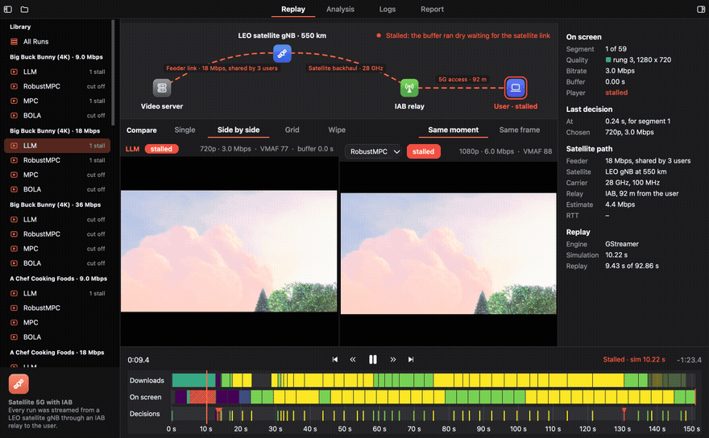
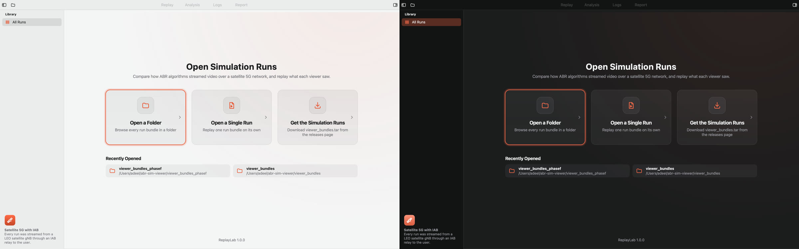
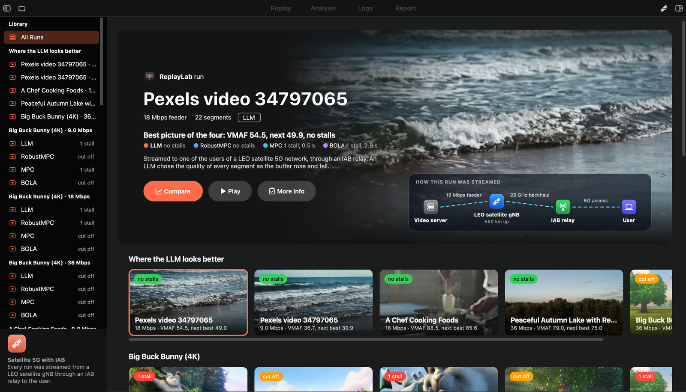
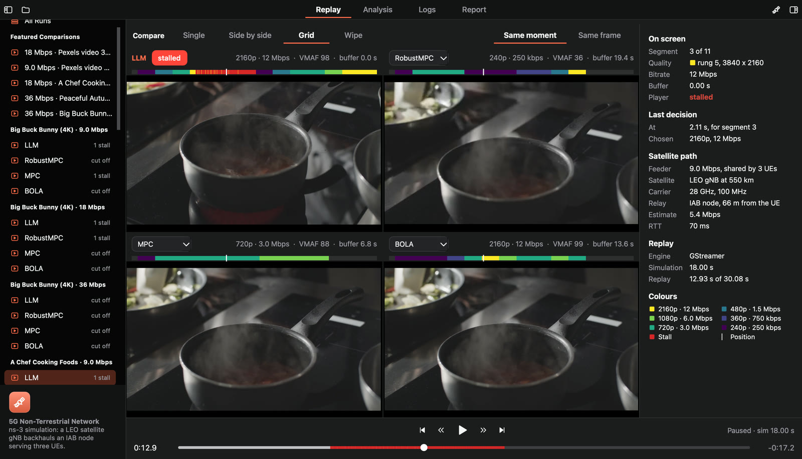
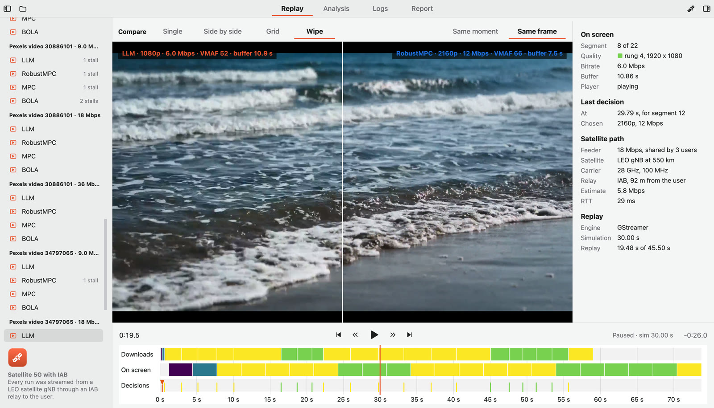
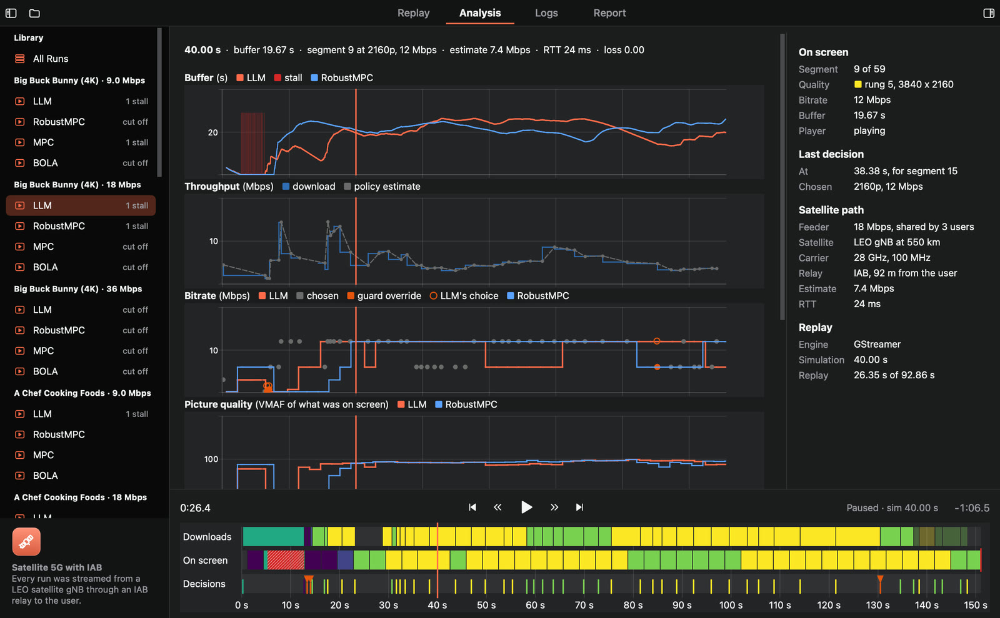
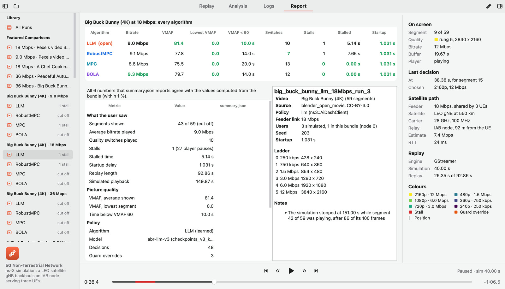

# ReplayLab


Compares adaptive bitrate (ABR) algorithms by replaying ns-3 simulations of video streaming
over a satellite 5G network with integrated access and backhaul (IAB). Each run is played as
the viewer saw it, segment by segment, with its stalls. Runs of different algorithms on the same
video and link can be played side by side, in a grid or in one frame split by a divider, with
their buffer, bitrate and picture quality (VMAF) drawn on the same charts.

The algorithms in the data are an LLM-based policy, RobustMPC, MPC and BOLA. Network: a LEO
satellite gNB at 550 km (28 GHz, 100 MHz) backhauls an IAB relay, which serves three users. The
video server reaches the satellite over a feeder link of 9, 18 or 36 Mbps.

Built with C++20, Qt 6 and GStreamer.



[Full-quality video (MP4)](docs/images/compare.mp4)

## Download

Packages for macOS (Apple silicon), Windows and Linux are on the
[Releases](https://github.com/muhammadadeelzahid/replay-lab/releases) page, with the 14 LLM
runs (`viewer_bundles.tar`). Extract the runs, open the app and choose the `viewer_bundles`
folder. The comparison runs are described under [Simulation data](#simulation-data).

- macOS: unzip and move the app to Applications. The first time, right-click it and choose
  Open (the app is not notarised).
- Windows: unzip and run `replaylab.exe`.
- Linux: `chmod +x` the AppImage and run it.

The packages include ffmpeg and use the pre-rendered engine: the first time a run is played,
its video is rendered (a few seconds) and cached. Build from source for the GStreamer engine.

## Features

- The experiments where the LLM's picture is clearly better listed first, each opening next to
  the algorithm it beats most, at the moment it shows best
- Library grouped by video and feeder link rate, one entry per algorithm, with stalls and
  cut-off playback marked
- Replay of one run, two side by side, a grid of up to four, or two in one frame split by a
  divider that can be dragged, with a 2x magnifier
- Runs lined up at the same moment of the session or at the same frame of the video, with each
  run's rungs on screen in a strip above its video
- The network path (server, satellite, IAB relay, user) shown on request from the toolbar
- Charts of buffer, throughput, bitrate, VMAF, RTT, loss and decision delay, with the compared
  runs drawn over the open one
- A scoreboard of every algorithm of an experiment: bitrate, VMAF, switches, stalls, stalled
  time and startup, with the best of each marked
- Indexed, filterable `sim.log` and policy log
- QoE report checked against `summary.json`

## Screenshots

The app follows the system's light or dark appearance.



**All Runs.** Featured Comparisons come first: the experiments where the LLM looks clearly better. The featured one shows how
each algorithm did on the same video and link; Compare opens the LLM run next to the algorithm
it beats most, lined up by frame, at the moment its picture is furthest ahead.



**Grid.** The four algorithms at the same moment: the LLM run is stalled at 2160p while
RobustMPC plays at 240p.



**Wipe.** Two algorithms in one frame, at the same frame of the video: 1080p on the left,
2160p on the right.



**Analysis.** Buffer, throughput, bitrate and VMAF of the compared runs, one colour per
algorithm.



**Report.** The scoreboard of every algorithm above the open run's QoE report.



## Reading the comparison

- **The runs are separate simulations.** Runs with the same video, rate and run number share a
  seed, but the network does not behave identically across them, so differences are not due to
  the algorithm alone.
- **Stalls are counted as episodes.** The ns-3 player resumes on single frames, so one freeze
  is logged as many short stalls. Stalls separated by less than 1 s of playback are merged into
  one episode; the report gives both counts ("1 (27 player pauses)").
- **Big Buck Bunny is partial.** Every session stops at about 151 s, when the satellite pass
  ends, at the same point for every algorithm.
- **Same moment and same frame.** A simulated segment takes 3.3 s of session time but holds
  2 s of video, so in Same moment a pane that is playing moves ahead of one that is stalled.
  Same frame keeps the video in step instead.
- **Featured Comparisons.** An experiment is listed when the LLM's mean VMAF is at
  least 2 points above every other algorithm's and it stalled no longer than the others. It is
  computed from the bundles when a folder is opened; with this data, 5 of the 15 experiments.
- **The grid is best effort at 4K.** Four 2160p videos decoded at once can be more than the
  CPU keeps up with; panes are then kept in step by jumping, not smoothly.

## Replay engines

- **GStreamer** (default): plays the segment files directly.
- **Pre-rendered**: renders the experienced video once with `ffmpeg`, then plays it with Qt
  Multimedia. Used when GStreamer is not available.

Select the engine in Settings or with `--engine gstreamer|prerendered`.

## Requirements

- CMake 3.24+, Ninja, a C++20 compiler
- Qt 6.8+ (Widgets, Charts, Multimedia, Svg, Concurrent, Test)
- GStreamer 1.22+ with the base, good, bad and libav plugins (optional)
- ffmpeg

On macOS:

```sh
brew install qt cmake ninja gstreamer ffmpeg
```

## Build

```sh
cmake --preset release
cmake --build --preset release
ctest --preset release
```

Other presets: `debug`, `nogst` (without GStreamer), `asan`, `tsan`, and `dist` for the release
packages (see `packaging/` and `.github/workflows/release.yml`; pushing a `v*` tag builds all
three and drafts a release).

## Run

```sh
open "build/release/app/ReplayLab.app"
```

From the command line:

```sh
APP="build/release/app/ReplayLab.app/Contents/MacOS/ReplayLab"
"$APP" viewer_bundles_phasef --bundle big_buck_bunny_llm_18Mbps_run_3 --time 10 --layout side
```

On Linux the executable is `build/release/app/replaylab`.

| Option | Effect |
| --- | --- |
| `--bundle <name>` | open a run of the folder |
| `--time <s>` | move the cursor to a simulation time |
| `--engine gstreamer\|prerendered` | replay engine |
| `--page library\|replay\|analysis\|logs\|report` | view to show |
| `--layout single\|side\|grid\|wipe` | runs shown on the Replay page |
| `--align moment\|frame` | line the runs up by session time or by video frame |
| `--size WxH` | window size |
| `--screenshot <file.png>` | save a screenshot and quit |
| `--profile <s>` | play for some seconds and print timings |
| `--record <folder>` | play and save a picture of the window every 100 ms, then quit (`--duration <s>`, default 8) |

| Key | Action |
| --- | --- |
| Space | play / pause |
| ⌥← / ⌥→ | back / forward 5 s |
| ⌘[ / ⌘] | previous / next segment |
| ⌘1 … ⌘5 | All Runs, Replay, Analysis, Logs, Report |
| ⌃⌘S / ⌥⌘I | sidebar / inspector |
| ⌘O / ⇧⌘O | open a folder / a run |
| ⌘R | render the video |
| ⌘, | settings |

The pictures in this README were made with the app itself (`ABRVIZ_APPEARANCE=light` or
`dark` picks the appearance):

```sh
"$APP" viewer_bundles_phasef --bundle big_buck_bunny_llm_18Mbps_run_3 --time 10 --layout side \
    --size 1440x900 --record frames --duration 10
ffmpeg -framerate 10 -i frames/frame-%04d.png -vf "fps=8,scale=880:-1:flags=lanczos,\
split[a][b];[a]palettegen=max_colors=144[p];[b][p]paletteuse=dither=bayer" docs/images/compare.gif
"$APP" viewer_bundles_phasef --bundle chef_cooking_llm_9Mbps_run_4 --time 18 --layout grid \
    --size 1440x900 --screenshot grid.png
```

Command-line tools in `build/release/tools/`: `validate_bundle`, `print_report`,
`render_experienced`.

## Simulation data

Neither data set is in git.

- **`viewer_bundles_phasef`** (60 runs, about 7.9 GB): 5 videos × 4 algorithms (LLM,
  RobustMPC, MPC, BOLA) × 3 feeder rates, with VMAF, SSIM and PSNR for every segment and
  quality. It is larger than a GitHub release allows (2 GB per file) and is shared separately.
  Extract it into the repository root.
- **`viewer_bundles`** (14 LLM runs, about 714 MB): `viewer_bundles.tar` on the Releases page.

See [Simulation data](docs/simulation-data.md) for the bundle format.

## Documentation

API documentation is generated with Doxygen (`brew install doxygen`):

```sh
cmake --build --preset release --target docs
open build/release/docs/html/index.html
```

- [Architecture](docs/architecture.md)
- [Diagrams](docs/diagrams.md)
- [Simulation data](docs/simulation-data.md)

## Credits

- *Big Buck Bunny* © Blender Foundation, [CC-BY 3.0](https://creativecommons.org/licenses/by/3.0/)
- Other videos from [Pexels](https://www.pexels.com), [Pexels License](https://www.pexels.com/license/)

## Licence

MIT, see [LICENSE](LICENSE).
