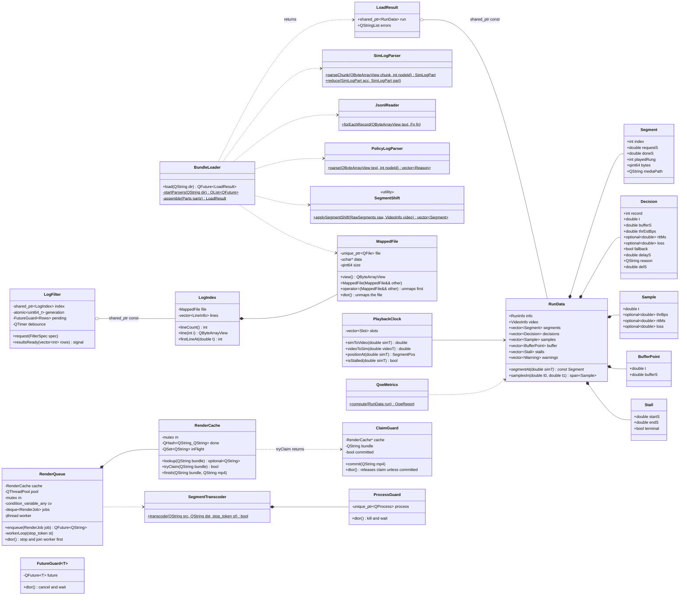
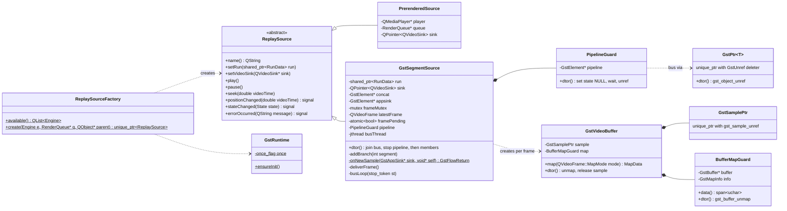
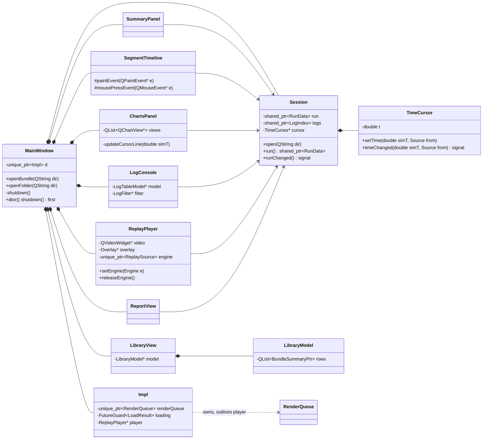
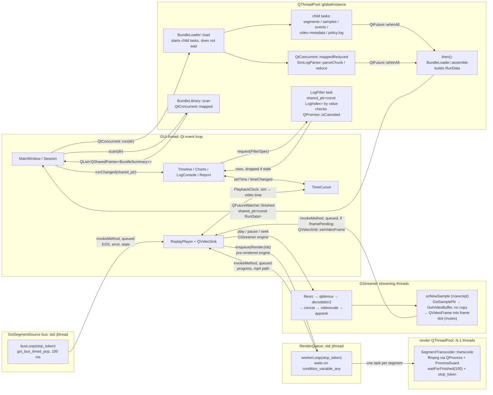

# abr-viz: diagrams

Class and threading diagrams for [ARCHITECTURE.md](ARCHITECTURE.md). They are Mermaid
diagrams: GitHub and VS Code's Markdown preview render them.

Notation in the class diagrams:
- `*--` owns (Qt parent, `std::unique_ptr` or plain member);
- `o--` shares (`std::shared_ptr` / `QSharedPointer`);
- `-->` uses or observes (holds a pointer or connects to its signals);
- `..>` calls or creates;
- `$` = static; `dtor` = what the destructor does (RAII).

C++ templates are written with `~`: `vector~Segment~` is `std::vector<Segment>`.

## 1. Core: data, loading, logs, rendering (`core/`)

## 2. Media: replay engines and GStreamer RAII (`media/`)

Members of `GstSegmentSource` are listed in declaration order. They are destroyed in reverse,
and the destructor also does it explicitly: the bus thread is stopped and joined, then
`PipelineGuard` sets the pipeline to `NULL` (no streaming thread runs after that), then the
frame slot and the rest are destroyed (design fix D1). `concat` and `appsink` are non-owning:
the pipeline owns them (D3). `GstVideoBuffer` hands each frame to Qt without copying it (D16).

## 3. App: GUI (`app/`)

`~MainWindow()` starts with `shutdown()`: it waits for pending futures and destroys the replay
engine **before** `Impl` (and the `RenderQueue`) is destroyed. Member order alone is not
enough here, because C++ destroys `MainWindow`'s members before the `QWidget` base deletes
child widgets such as `ReplayPlayer` (D11). `BundleSummaryPtr` is `QSharedPointer<const BundleSummary>`. Every `shared_ptr~RunData~` is
`std::shared_ptr<const RunData>`. Panels get the run from `Session::runChanged` and keep their
own `shared_ptr`.

## 4. Threads, data and calls

Each box is a thread (or a pool of threads); each arrow is a call or a hand-off, labelled with
the function and the data that crosses.

What is shared between threads, and how it is protected:

| Data | Shared by | Protection |
| --- | --- | --- |
| `shared_ptr<const RunData>` | GUI, loader, filters, GStreamer engine | Immutable after loading: no lock |
| Filter generation counter | GUI, filter tasks | `std::atomic<uint64_t>` |
| `RenderCache` | GUI, `RenderQueue` worker | `std::mutex` + `std::scoped_lock`; claims released by `ClaimGuard` |
| `shared_ptr<const LogIndex>` | `Session`, filter tasks | Immutable after indexing: no lock; tasks hold copies |
| `RenderQueue` job queue | GUI (producer), worker (consumer) | `std::mutex` + `std::condition_variable_any` |
| GStreamer frame slot | streaming thread (writes), GUI (reads) | `std::mutex`, plus `std::atomic<bool> framePending` |
| Progress counters | workers (write), GUI (read) | `std::atomic<int>` |
