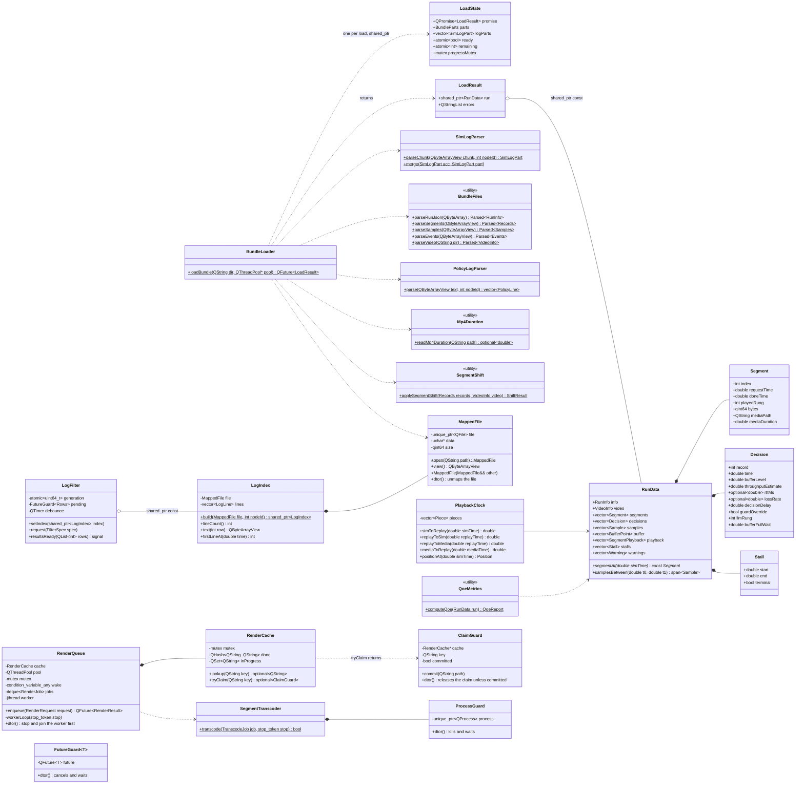
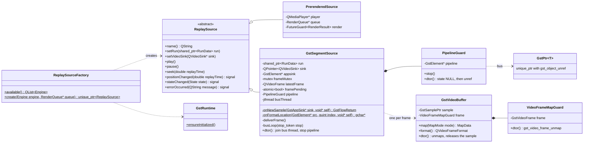
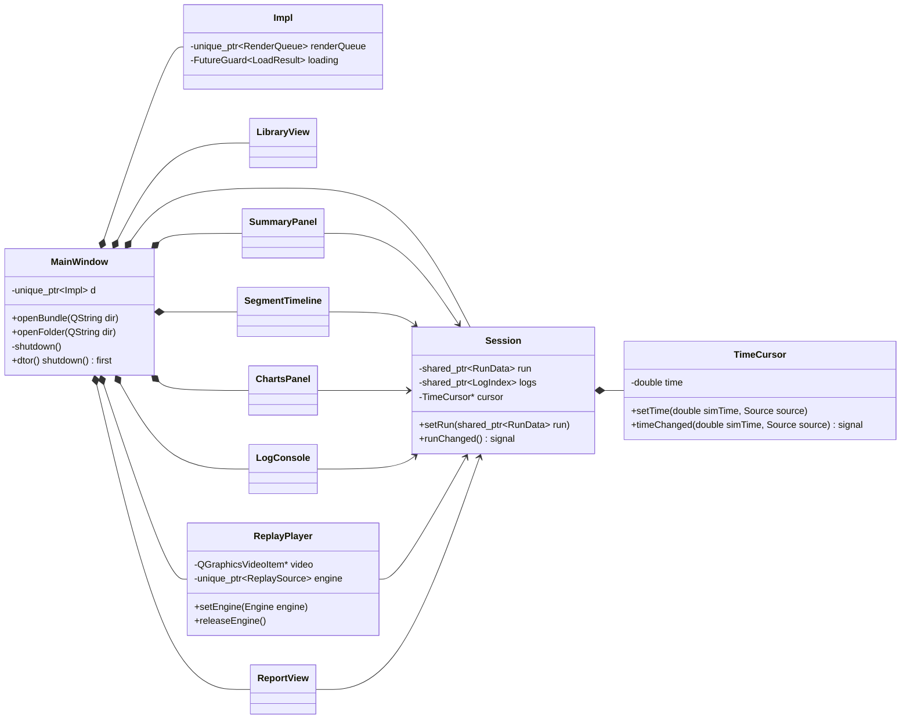
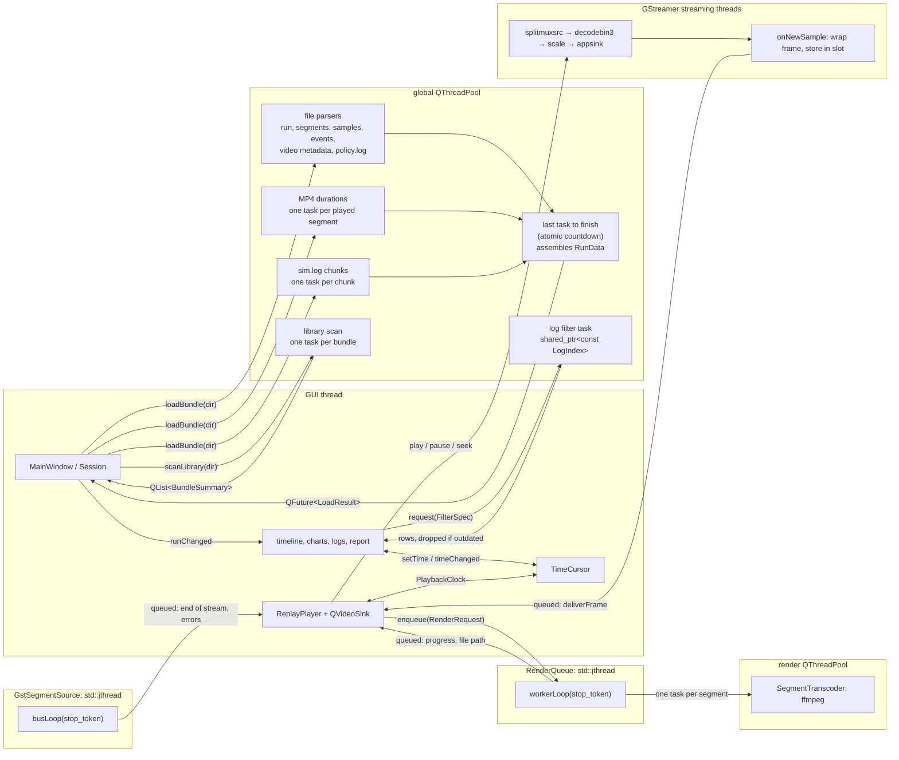

# Diagrams

Class and thread diagrams for [architecture.md](architecture.md), in Mermaid (rendered by
GitHub and most Markdown previews).

Class diagram notation:
- `*--` owns (Qt parent, `std::unique_ptr` or member);
- `o--` shares (`std::shared_ptr` or `QSharedPointer`);
- `-->` uses or observes;
- `..>` calls or creates;
- `$` static; `dtor` what the destructor does.

Templates are written with `~`: `vector~Segment~` is `std::vector<Segment>`.

## Core

## Media

`GstSegmentSource` members are listed in declaration order and destroyed in reverse: the bus
thread is joined, the pipeline is stopped (no streaming thread runs after that), then the frame
slot is destroyed. `appsink` is owned by the pipeline.

## GUI

`~MainWindow()` calls `shutdown()` before anything is destroyed: pending loads are cancelled and
awaited, and the replay engine is destroyed before `Impl` destroys the `RenderQueue` it points
to.

## Threads

Each box is a thread or a pool; each arrow is a call or a hand-off, labelled with the function
and the data that crosses.

| Shared between threads | Protection |
| --- | --- |
| `shared_ptr<const RunData>`, `shared_ptr<const LogIndex>` | immutable, no lock |
| load setup and task results | `std::atomic` release/acquire and an acq_rel countdown |
| load progress and result | `QPromise` |
| log filter generation, render progress | `std::atomic` |
| render job queue | `std::mutex`, `std::condition_variable_any` |
| `RenderCache` | `std::mutex`, `ClaimGuard` |
| GStreamer frame slot | `std::mutex`, `std::atomic<bool>` |
